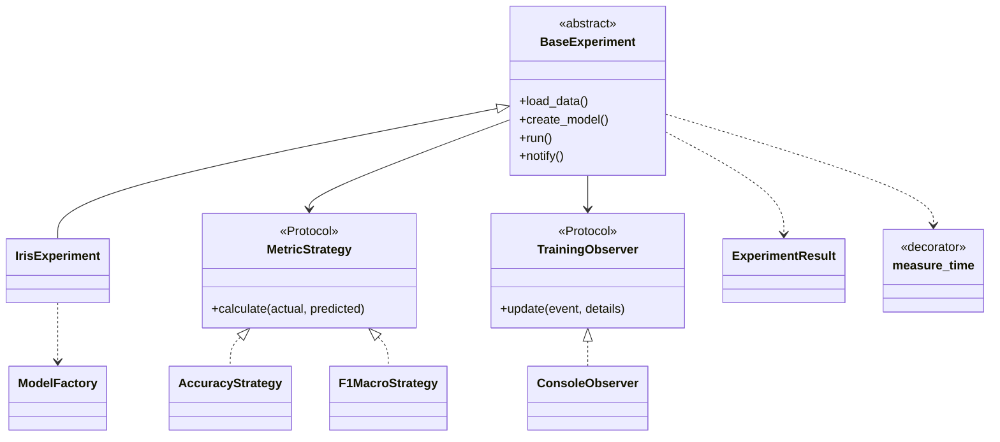

# Mini projekat 2 - Mini okvir za ML eksperimente

## Opis
Mali framework za pokretanje ML eksperimenata na Iris skupu podataka.

## Sabloni dizajna
1. **Factory** (`ModelFactory`) kreira Logistic Regression, Decision Tree ili kNN.
2. **Strategy** (`MetricStrategy`) omogucava izbor Accuracy ili F1-macro metrike.
3. **Observer** (`TrainingObserver`) prati pocetak treninga, zavrsetak i evaluaciju.
4. **Template Method** (`BaseExperiment.run`) definise zajednicki tok eksperimenta.
5. **Decorator** (`measure_time`) mjeri trajanje eksperimenta.

## Mermaid dijagram klasa



## Instalacija i pokretanje
Potrebni su Python 3.11-3.14 i `uv`.

```bash
uv sync
uv run python main.py
```

## Testiranje
```bash
uv run pytest -v
uv run ruff check .
uv run ruff format --check .
```

Projekat sadrzi sedam testova za Factory, Strategy, Observer i Iris eksperiment.

## AI alati
AI alat je koriscen kao pomoc pri planiranju strukture, primjeni sablona dizajna i predlaganju testova. Generisani kod treba provjeriti pokretanjem testova.

### Promptovi
- "Predlozi jednostavan Python framework za ML eksperimente koji koristi Factory za modele, Strategy za metrike, Observer za pracenje, Template Method za tok eksperimenta i Decorator za mjerenje vremena."
- "Napravi pytest testove za Factory, Strategy, Observer i eksperiment na Iris skupu podataka."
- "Pregledaj da li su trazeni sabloni jasno primijenjeni i predlozi Mermaid dijagram klasa."

### Korekcije i provjere
- Nepoznat naziv modela izaziva jasnu ValueError gresku.
- Metrika i Observer su odvojeni od logike eksperimenta.
- Vrijeme se cuva na objektu eksperimenta nakon izvrsavanja.
- Nakon lokalnog pokretanja dopuniti README stvarnim rezultatima i svim dodatnim korekcijama.
